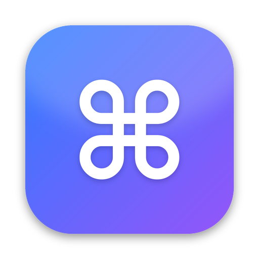
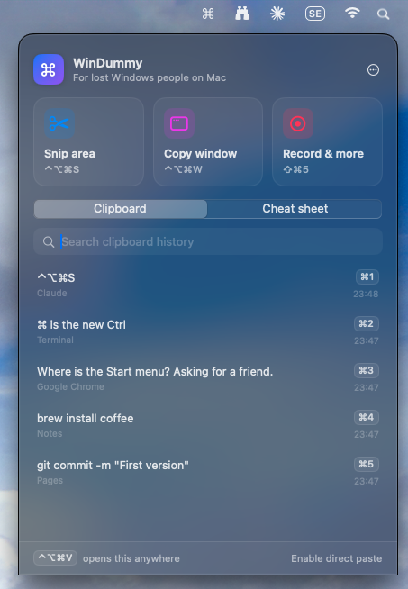

<p align="center">
  
</p>

<h1 align="center">WinDummy</h1>

<p align="center">
  For lost Windows people on Mac.
</p>

---

You switched to a Mac and you keep reaching for `Win+Shift+S` and `Win+V`. WinDummy is a tiny menu bar app that gives those habits back, one click or one hotkey away, and teaches you the Mac way while you use it.

<p align="center">
  
</p>

## What it does

| | On Windows | Here |
|---|---|---|
| **Snip an area** to the clipboard | `Win+Shift+S` | `⌃⌥⌘S` |
| **Copy a window** to the clipboard by clicking it | `Alt+PrtScn` | `⌃⌥⌘W` |
| **Clipboard history**: choose what to paste | `Win+V` | `⌃⌥⌘V` |

The hotkeys use the same letters as on Windows, combined with `⌃⌥⌘`: the three keys in the bottom-left corner of the keyboard.

Everything lives in one floating panel. Click the ⌘ icon in the menu bar, or press `⌃⌥⌘V` anywhere:

- **Quick actions** for snipping an area, copying a window, and opening the macOS screenshot and recording toolbar.
- **Clipboard** tab: the last 40 things you copied, text and images. Type to filter, press Return to paste the top hit, or press `⌘1` to `⌘9`.
- **Cheat sheet** tab: about 60 Windows shortcuts translated to their Mac equivalents. Search by the Windows keys (`Alt+Tab`) or by what you want to do (`rename`).

Clipboard history is kept in memory only. Nothing is written to disk, and it is gone when you quit. Entries that password managers mark as secret are never recorded.

## Build and run

You need macOS 14 or later and the Xcode Command Line Tools. Full Xcode is not required.

```sh
xcode-select --install        # once, if you do not have the tools yet

git clone <this repository>
cd windummy
./scripts/build-app.sh --run
```

The app bundle ends up in `build/WinDummy.app`. Drag it to `/Applications` if you want to keep it, and turn on **Launch at login** from the ⋯ menu in the panel.

While developing you can also open `Package.swift` in Xcode, or run `swift run` from the terminal.

## Permissions

macOS asks for these the first time they are needed.

| Permission | Why | Required? |
|---|---|---|
| Screen & System Audio Recording | Snipping an area or a window | For the snip actions |
| Accessibility | Pressing `⌘V` for you after you pick a clip, the way `Win+V` pastes | Optional. Without it the clip is put on the clipboard and you press `⌘V` yourself |
| Paste from other apps | Reading the clipboard to build the history. Newer macOS versions may ask | For clipboard history |

The build script signs the app ad hoc. macOS ties permissions to the signature, so it may ask again after you rebuild. To keep them between builds, sign with a real identity:

```sh
CODESIGN_IDENTITY="Apple Development: you@example.com (TEAMID)" ./scripts/build-app.sh
```

## How it is built

Swift, with AppKit for the plumbing and SwiftUI for everything you see. No dependencies.

```
Sources/WinDummy/
├── main.swift                  Entry point (menu bar only, no Dock icon)
├── App/
│   ├── AppDelegate.swift       Menu bar icon, panel, hotkeys
│   ├── FloatingPanel.swift     A panel that takes focus without activating the app
│   ├── PanelModel.swift        UI state
│   └── HoverTracker.swift      Which row the pointer is over
├── Services/
│   ├── ClipboardStore.swift    Clipboard history
│   ├── HotKeyCenter.swift      Global hotkeys (Carbon)
│   ├── ScreenCapture.swift     Wraps the system `screencapture` tool
│   └── Paster.swift            Sends ⌘V
├── Data/
│   └── CheatSheet.swift        The shortcut translations
└── Views/                      SwiftUI views
```

Two details worth knowing if you read the code:

- The panel is a **non-activating** `NSPanel`. It can take keyboard focus while the app you were working in stays the active app, which is why a paste lands exactly where your cursor was.
- Global hotkeys go through Carbon's `RegisterEventHotKey`. It is old, but it needs no Accessibility permission and it swallows the key press.
- The views use no `@State`. In recent SDKs it is a macro whose compiler plugin ships only with full Xcode, so view state lives in small observable objects instead. That keeps the project buildable with just the Command Line Tools.

## Add your own shortcuts

The cheat sheet is one plain Swift file, `Sources/WinDummy/Data/CheatSheet.swift`. Add a line and rebuild:

```swift
Shortcut("Lock the screen", win: "Win+L", mac: "⌃⌘Q"),
```

Corrections and additions are welcome, especially for non-US keyboard layouts.

## Ideas

- Arrow-key navigation in the clipboard list
- Pinned clips that survive a restart
- Configurable hotkeys
- More languages

## License

MIT. See [LICENSE](LICENSE).
